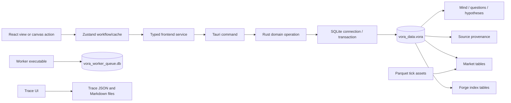

# SKDDA Phase 0 — Repository Architecture Audit

**Audit type:** Read-only source/documentation inspection  
**Baseline:** Repository state at the time this Phase 0 audit was prepared  
**Purpose:** Record verified architecture and implementation evidence before SKDDA implementation. This is not a runtime certification.

## 1. Executive findings

Vora Mind is a local-first Tauri desktop application with a React/TypeScript frontend and Rust backend. The main workspace database is SQLite and is initialized by composing Rust module schema initializers. A separate worker process has its own queue SQLite database. Forge's code index and Market persistence use connections to the main `.vora` workspace file, although some Market commands open their own connection. Tick Parquet files, Trace files, workspace assets, and settings JSON exist outside SQLite.

Useful reusable infrastructure is real and persisted: source/segment/extract provenance and revision events; versioned board/library snapshots; questions and an inquiry triage workflow; a hypothesis/Lab workflow; SQLite transactions in selected operations; backup/import/export; typed Tauri command and frontend service patterns. These systems are not yet one scientific domain. In particular, scientific projects, experiment runs, dataset versions, evidence/finding records, statistical analysis provenance, first-class model versions, learning mastery, and cross-project knowledge transfer were not established by this inspection.

The strongest immediate architectural risks are not absence of a particular screen. They are inconsistent persistence contracts (including a duplicated historical SQL file), no unified migration ledger, incomplete or absent foreign keys on scientific references, polymorphic source links without target FKs, and uneven guarantees across independently opened connections. Existing operation-level tests demonstrate selected behavior, but they do not prove all workflows against every deployed workspace database.

## 2. Scope and evidence standard

Inspected the repository structure and the relevant source, backend, frontend, SQL, and documentation paths listed below. Existing focused audit documents [RECON.md](../../docs/audit/RECON.md), [RECON_INQUIRY.md](../../docs/audit/RECON_INQUIRY.md), and [RECON_MARKET_DATA.md](../../docs/audit/RECON_MARKET_DATA.md) were used as repository-specific evidence and cross-checked against source/schema entrypoints where noted.

This audit distinguishes:

- **Verified in code/schema:** the implementation or SQL declaration exists in the inspected repository.
- **Partially verified:** code path exists, but its complete runtime integration or all deployed database variants were not executed.
- **UNVERIFIED:** cannot be established from source inspection alone or would require unsafe access to user data/runtime state.

No application database was opened, no test suite was run, no application source/SQL was changed, and no migration was executed. Therefore live contents, installed-app behavior, database integrity on user machines, and end-to-end UI behavior are **UNVERIFIED**. Unit tests in source were inspected but not executed.

## 3. Repository architecture map

### 3.1 Frontend

| Area | Actual responsibility / evidence |
|---|---|
| App shell and orchestration | `src/App.tsx` composes board, planning, Lab, source, chart, and navigation surfaces. It also contains cross-surface workflows such as creating a hypothesis from a board source. |
| Mind canvas and persistence DTOs | `src/mind/types/index.ts`, `src/mind/services/dbService.ts`, `src/mind/components/canvas/`, and `src/shared/canvas/useVoraFlow.ts`. |
| Shared state | `src/shared/store/useAppStore.ts` holds board/library and workflow cache state, including questions and hypotheses; it calls frontend DB services. |
| Source UI | `src/pages/sources/` contains source list/detail/add/segment flows. `src/source/services/sourceService.ts` is a frontend source adapter. |
| Research-like UI | `src/shared/layout/QuestionsBoardPage.tsx`, `InquiryTriagePanel.tsx`, `HypothesesList.tsx`, `HypothesisDetail.tsx`, promotion/child/source modals, and canvas hypothesis node. |
| Market/chart | `src/pages/MarketPage.tsx`, `ChartPage.tsx`, `src/components/market/`, and `src/lib/market/`. Market/chart history and chart snapshots are their own workflows, not a scientific experiment system. |
| Trace | `src/features/vora-trace/` uses `traceStore.ts` and `src/mind/services/traceService.ts`; it is a separate decision graph and local-file workflow. |
| Forge | `src/forge/` exposes code intelligence and agent operations; not scientific domain research. |

### 3.2 Backend

`src-tauri/src/lib.rs` registers Tauri commands and initializes the shared app state. Domain code lives under:

- `mind/`: canvas/board persistence, snapshots, questions, hypotheses, library groups, media, task flow, journal, portable database/backup.
- `source/`: source DTOs, database operations, IPC, hierarchy and revision handling.
- `market/`: market persistence, IPC, chart domain calculations, local tick data access.
- `forge/`: code index, semantic graph, identity, patching, lineage, audit.
- `vora_trace.rs`: Trace domain and disk-oriented command integration.
- `bin/vora_worker.rs`: independent worker executable, queue database, task execution and logs.

Tauri commands in `lib.rs` generally acquire shared `AppState` and delegate to domain functions. `source::ipc` provides source IPC separately. Database initialization is composed in `mind::portable_db::initialize_workspace_schema`; `lib.rs` setup invokes it against the default workspace DB. `src-tauri/src/schema.sql` is not the complete runtime initializer: canvas schema comes from Rust, source and market schemas from `src-tauri/schema_source.sql` and `schema_market.sql` included by their Rust modules.

### 3.3 Persistence dependency map

The diagram shows code-level ownership, not a complete runtime trace or all platform-specific paths.

## 4. Representative persistence traces

### 4.1 Create board

1. Board UI/canvas is composed in `src/App.tsx` and canvas helpers under `src/shared/canvas/`.
2. Frontend DB operations are provided by `src/mind/services/dbService.ts` and state actions in `src/shared/store/useAppStore.ts`.
3. `lib.rs::create_board` validates title, creates ID/time, locks `AppState.db`, calls `mind::canvas_db::create_board`.
4. `canvas_db.rs` owns board/version/snapshot tables and uses transactions for version/snapshot operations.
5. Durable store is the active `.vora` file resolved in Tauri setup. Board version/snapshot resolver behavior is in `mind/resolver.rs`.

The source path is **verified in code**. Actual user interaction and restart round-trip were not run (**UNVERIFIED**).

### 4.2 Create source / extract

1. Source UI is under `src/pages/sources/`; frontend adapter is `src/source/services/sourceService.ts`.
2. `source::ipc` dispatches operations to `source::db`; `source::db::create_source` inserts a source and records a `source_revisions` create event.
3. Segments point to sources; extracts point to segments and can point to parent/superseding extracts; links point to extracts.
4. `source_revisions` has SQLite triggers blocking UPDATE/DELETE. Other source row mutations are represented by application-level revision writes, not automatically guaranteed by database trigger for every arbitrary SQL write.
5. Source SQL is loaded from `src-tauri/schema_source.sql`, with hierarchy migration in `source/db.rs`.

Repository code confirms intended source operations and schema. End-to-end source UI/persistence behavior on a production workspace is **UNVERIFIED**.

### 4.3 Promote question to hypothesis

1. Questions are displayed and triaged through `QuestionsBoardPage.tsx` / `InquiryTriagePanel.tsx`.
2. `src/mind/services/dbService.ts` invokes typed commands; `useAppStore.ts` owns async cache actions.
3. Tauri command registration in `lib.rs` routes to functions in `mind/hypothesis.rs`.
4. The promotion operation checks question status/selection, inserts a hypothesis, updates question promotion state, and writes related records inside a SQLite transaction. Existing Rust tests cover promotion success and rejection cases.
5. The `hypotheses` schema has no declared FK for `inquiry_id`; promotion consistency is enforced in code. `questions.promoted_to_hypothesis_id` is also a soft reference.

This is a real workflow with persistence and transactional code, but its scientific experiment, observation, evidence, and analysis semantics are incomplete. UI/runtime use is **UNVERIFIED**.

## 5. Existing independent domains

### Vora Trace

Trace has graph DTOs and UI, decision/experiment node kinds, project scanning, JSON graph persistence and Markdown decision files. Its experiment node is a visualization/decision record, not a persisted scientific `ExperimentDesign`/`ExperimentRun`; project registry is not an SKDDA `ResearchProject`. The store can fall back to `mockGraph` outside Tauri and catches disk errors into UI state. See `src/features/vora-trace/store/traceStore.ts`, `src/mind/services/traceService.ts`, `src-tauri/src/vora_trace.rs`. No Trace-to-SKDDA canonical entity relation was verified.

### Market and chart

Market SQL tables include candles, detected boxes, scale metadata, drawing templates and alerts. OHLCV may be derived from Parquet tick assets (`data/ticks`) by `market/local_db.rs`; candle, chart and drawing persistence is not an experiment-run, immutable dataset-version or analysis-run framework. Some market commands call `open_default_db_connection()` and initialize market schema on a new connection. They share the default DB path but do not necessarily use the application-held connection.

### Forge and worker

Forge maintains code workspace/snapshot/symbol/lineage/audit/index tables. Main-app Forge connections use the active `.vora` path; the worker creates/uses `vora_worker_queue.db` for job/task state and may call Forge code separately. Code lineage/audit is not scientific research lineage. Worker task status and output is not equivalent to an experiment run.

### Files and assets

Documents/media records and paths are in the Mind workspace DB. Local files, Parquet tick data, Trace graph/Markdown, and workspace assets remain file-backed. A complete asset lifecycle/backup guarantee for all external file references is **UNVERIFIED**; database backup alone cannot be assumed to bundle external assets.

## 6. Reusable infrastructure versus target gaps

**Reuse/extend:** workspace SQLite connection and backup APIs; source provenance and review fields; question triage; existing hypothesis protocol and verdict flow; board snapshots and library versions as presentation/versioning primitives; Tauri command/service/store layering; market data adapters where a future dataset manifest explicitly captures inputs; existing tests as examples.

**Do not misclassify:** `TraceNodeKind::Experiment`, market candles, hypothesis JSON entries, chart snapshots, board/library snapshots, Forge lineages, and task/worker queues are not complete scientific entities merely because their names or shapes resemble target concepts.

**Major missing domains:** project/domain/gap, knowledge claims/concepts/principles/framework versions, learning mastery, phenomenon/observation, experiment design/run, datasets/versions/samples, analysis runs, evidence/findings, model registry/version/evaluation, validation/replication, universal typed scientific relations, and cross-project transfers.

## 7. Runtime and repository test coverage

Rust module tests are present for questions, hypothesis promotion/verdicts, source operations, schema helpers, board versions, database backup/import, and other features. `Cargo.toml` declares Rust tests; `package.json` has build/type-check scripts but no repository-level frontend test runner script was established by the audit. No test command was run because the assignment is read-only and tests can create files or touch configured paths; existing tests were inspected, not executed.

The following are explicitly **UNVERIFIED**:

- Whether all currently used user databases pass `PRAGMA integrity_check`/`foreign_key_check`.
- Exact production data location for every invocation and environment.
- Runtime connection configuration for every command path/platform.
- Backup coverage for external documents/media/tick assets/Trace files.
- Full UI workflows and persistence round-trips after restart.
- Whether every relevant Rust unit test runs safely without modifying user data.

## 8. Audit references

- Master target: [VORA_MIND_SCIENTIFIC_ARCHITECTURE.md](../../VORA_MIND_SCIENTIFIC_ARCHITECTURE.md)
- DB inventory and known schema details: [RECON.md](../../docs/audit/RECON.md)
- Inquiry lifecycle details: [RECON_INQUIRY.md](../../docs/audit/RECON_INQUIRY.md)
- Market subsystem audit: [RECON_MARKET_DATA.md](../../docs/audit/RECON_MARKET_DATA.md)
- Key implementation: `src-tauri/src/{lib.rs,mind/portable_db.rs,mind/canvas_db.rs,mind/questions.rs,mind/hypothesis.rs,mind/library_groups.rs,source/db.rs,source/ipc.rs,market/db.rs,market/local_db.rs,forge/index.rs,vora_trace.rs,bin/vora_worker.rs}`.
