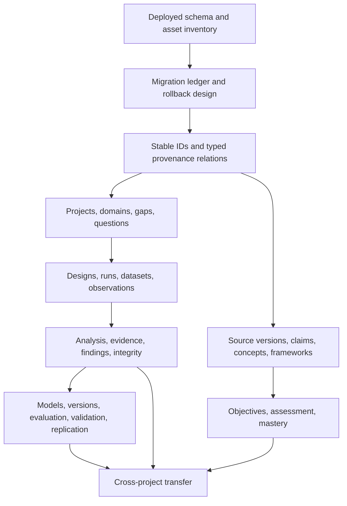

# SKDDA Phase 0 — Migration Strategy

**Constraint:** No migration is implemented or executed by this Phase 0 package. This plan is a compatibility proposal to be refined after the current deployed database-version inventory is verified.

## 1. Existing state to preserve

Preserve IDs and contents of:

- Canvas/board: `mind_boards`, `mind_board_versions`, `library_item_groups`, `library_item_group_versions`, `objects`, `object_versions`, snapshot/delta/checkpoint tables, and `mind_text_links`.
- Source: `sources`, `segments`, `extracts`, `links`, `source_revisions`.
- Workflow: `task_flow_items`, `journal_entries`, `questions`, `hypotheses`, `hypothesis_definitions`, `hypothesis_insights`, `hypothesis_data_entries`, `hypothesis_snapshots`.
- Market: candles, boxes, registries, metadata, templates and alerts.
- Forge: code workspace, snapshots, file/symbol/lineage/index and audit tables.
- Portable items/snapshots/import metadata and user settings.
- Separate worker queue data, which is not scientific workspace data and must not be copied into research migrations.

Existing identifiers are referenced by canvas/board versions, hypothesis relations, source links, exports, and frontend state. Re-keying or merging entities based on title/text is prohibited.

## 2. Existing tables that may require extension

| Existing table/module | Potential extension | Compatibility rule |
|---|---|---|
| `sources` / `segments` / `extracts` | SourceVersion, citation/version pins, extraction tool/version provenance and reviewed-claim links. | Preserve records. Existing source revision history is not SourceVersion; do not synthesize edition IDs without explicit migration rule. |
| `links` | Typed target relation or staged bridge to relation registry. | Existing `target_kind/target_id/link_kind` remain readable until validated mapping exists; unknown target remains unresolved, not dropped. |
| `questions` | Project/domain/gap/pathway ownership and safe relation to hypothesis. | Existing question remains with `legacy/unassigned` project context where ownership is unknown. |
| `hypotheses` | Project/question FKs or relation rows, typed variables, lifecycle events, experiment/evidence linkage. | Preserve text fields and existing verdict; no inferred experiment/run or project. |
| `hypothesis_data_entries` | Optional staged legacy data import view. | Keep rows unchanged. Do not infer units, sample IDs, dataset version, or experimental method from JSON. |
| `library_item_groups` / versions | Framework registry/version relations or migration adapter. | Existing groups remain Library objects; map only after explicit user/review selection. Do not blanket-convert every group to framework. |
| `mind_snapshots` / canvas edges | Visualization references to canonical relation IDs. | Canvas edges remain visual history; do not automatically treat all as scientific predicates. |
| `market_candles` / Parquet inputs | Dataset adapter manifests and checksums. | Data becoming a scientific dataset requires explicit source range, provider, timeframe, schema, and version capture; no implicit immutable history claim. |
| Workspace schema/version metadata | Add centralized migration version registry after versioning design. | Must support all deployed variants; do not assume one schema shape from current initializer. |

## 3. New logical schema groups

Final table names and normalization require the approved ERD. Expected groups:

1. Migration/version ledger and migration integrity metadata.
2. Source versions/citations and typed claim/concept/principle/framework membership/version records.
3. Research projects, domains, project memberships, gaps, phenomena, observation plans and observations.
4. Learning objectives, assessment versions/attempts, competencies, progress and reproduction records.
5. Hypothesis/design versions, experiment runs, dataset identities/versions/split assignments/samples, analysis runs.
6. Evidence/finding records and typed scientific relation/junction tables.
7. Models/specifications/versions/parameters/evaluations/validations/replications.
8. Cross-project transfer/lineage and append-only lifecycle/provenance events.

Avoid one large migration that creates all groups before their ownership, FK behavior, and record identities are approved.

## 4. Safe legacy mapping

| Legacy data | Safe mapping | Must remain unknown/unassigned |
|---|---|---|
| `sources` row | Preserve as KnowledgeSource identity; map explicit existing kind/title/author/path/meta. | Edition/version, publication date, stable checksum, retrieval date if not stored. |
| `segments` row | Preserve as source segment and existing locator fields. | Exact SourceVersion if no version identity exists. |
| `extracts` row | Preserve transformation kind, content, segment, creator, review flag and parent/superseding IDs. | Whether content is a claim, concept, finding, validated fact, or correct extraction absent explicit type/review. |
| `links` row | Preserve original link and target strings. Map known `link_kind` to a bridge predicate only where endpoint lookup validates. | Dangling/missing targets, ambiguous target kinds, confidence/scope/provenance not present. |
| `source_revisions` row | Preserve event history exactly. | Mapping entity refs to new canonical registry unless endpoint exists and is proven. |
| `questions` row | Preserve content and current triage state. Existing promotion link may be validated against hypothesis ID. | Research project/domain/gap and scientific pathway. |
| `hypotheses` row | Preserve H0/H1, variable/metric/threshold strings, status/verdict/timestamps, existing parent/refinement IDs, raw text. | Project, dataset, experiment count/config, units, operational definitions, statistical method, reproducibility and validated-model claim. |
| `hypothesis_data_entries` JSON | Preserve byte/content-equivalent JSON and timestamps as legacy hypothesis entries. | Row-level observations, schema, units, variables/sample IDs, provenance, design/run association. |
| Library item group/version | Preserve as Library group and its exact snapshot/version. | KnowledgeFramework identity, epistemic validation, project origin, constituent concept/claim roles. |
| Canvas edges and snapshots | Preserve as visual history. | Scientific predicate unless user maps/reviews it. |
| Market candles/boxes | Preserve market domain. Create dataset manifests only through explicit versioned import/selection process. | Experiment design/run, data split, source coverage, provider provenance when not available. |
| Trace graph node/edge | Preserve Trace files/IDs. Optional explicit link/import through UI. | Scientific project, experiment, evidence, or validated result. |
| Worker task | Preserve operational queue separately. | Research run, experiment or analysis result. |

Do not derive scientific status or ownership from titles, card text, file paths, status words in prose, or node color.

## 5. Migration architecture and ordering

### Phase M0 — Inventory and freeze the compatibility matrix

Before any code: inspect actual deployed schema shapes from user-approved copies (never modify originals), establish app versions and all existing schema variants, verify both fresh and legacy defaults, identify connections, external assets and backup practices. Determine whether main DBs are `.vora` files and how older `.db` migration paths appear. Create sanitized fixtures.

### Phase M1 — Establish migration execution guarantees

Design a numbered/ordered migration ledger, one migration owner, transaction policy, preflight checks, backup gate, error reporting, post-migration integrity checks, and supported-from-version list. Keep per-domain SQL ownership but orchestrate deterministically. Migration failure must stop startup and leave a recoverable original/backup, not partially mark success.

### Phase M2 — Add shared identity/provenance compatibility

Add canonical scientific IDs/registry strategy only after relation integrity design. Backfill known endpoint identities with deterministic mapping and collision checks. Preserve unmapped source links/hypothesis references in a quarantine/unresolved report; no data deletion.

### Phase M3 — Add ResearchProject and explicit assignment

Create projects and joins; existing question/hypothesis records default to explicit unassigned legacy scope. Offer a reviewed UI operation to assign and record actor/time/reason. Do not auto-create one project per board or per title.

### Phase M4 — Add experiments and data

Create design/run, dataset/version, observations/samples and analysis manifests. Legacy hypothesis JSON remains untouched. Import to typed observation records only through a human-guided mapping that captures schema and source provenance.

### Phase M5 — Findings/models/transfer and learning

Add evidence/findings, model lifecycle and cross-project transfer after stable relation/version IDs. Learning/framework conversion is opt-in and separately reviewed.

Ordering dependencies:

## 6. Transaction, backup and rollback requirements

- Before schema/data migration, create a verified SQLite online backup of the active DB and preserve the original until post-migration validation succeeds.
- Validate the backup with `quick_check` and, after opening with FKs enabled, `foreign_key_check`; preserve a manifest/checksum.
- Do not assume database backup includes referenced documents/media, Parquet, Trace, or other filesystem assets. Define a workspace package contract or clearly report unresolved external asset refs.
- Run each migration transactionally when SQLite permits. DDL and data backfill must be atomic; migration ledger row commits only after validation.
- Use staged temporary DB for complex rebuilds and atomic replacement consistent with existing `portable_db` pattern. Never overwrite the active DB in place before staged validation.
- On failure: retain original DB, staged DB and diagnostics; do not suppress errors; avoid destructive cleanup until operator/user can recover.
- After successful migration: schema check, required-table/column check, FK check, representative provenance queries, row-count/checksum comparison, and app reopen test.
- Rollback for irreversible transforms is restore-from-backup, not an unsafe reverse SQL script. Document expected data-loss window and recovery step.

## 7. Fresh-install and existing-workspace compatibility

Fresh schema and upgraded schema must converge to the same declared version. Tests must cover:

- Empty DB.
- Current schema from repository.
- Each supported legacy workspace schema.
- Partial prior initialization where a module created tables but migration stopped.
- Existing source/hypothesis/library/canvas rows with null/unknown metadata.
- Repeated migration.
- Broken FK and invalid JSON fixtures.
- Interrupt/failure at every migration boundary.
- Backup/restore and settings-file association.

Do not require a one-time clean database or drop/recreate scientific tables. Existing feature compatibility must be verified for readers/writers during staged rollout.

## 8. Breaking-change and risk register

| Risk | Mitigation |
|---|---|
| `schema.sql` differs from actual Rust-composed runtime schema. | Treat runtime initializers and legacy DB fixtures as authority; document a single generated/owned schema strategy later. |
| No unified migration ledger; module initializers can partially apply. | Introduce ordered ledger and migration coordinator before significant new schema. |
| Foreign key setting is per connection, and default open helper does not enable it. | Centralize DB connection configuration; assert FK pragma on each path. |
| Existing weak/polymorphic references cannot map cleanly. | Preserve source IDs/strings; stage unresolved rows and reviewed mapping; never fabricate. |
| Existing child cascades may erase hypothesis data/history. | Decide deletion policy and migrate references before treating results as immutable scientific evidence. |
| Main `.vora` has Market/Forge/Mind tables together. | Keep one workspace DB initially; domain ownership is logical. No second scientific DB without a separate approved need. |
| External assets may not be in DB backup. | Build asset manifest/backup acceptance before claiming full workspace recovery. |
| Market migrations contain destructive one-time data changes for derived boxes. | Do not reuse Market migration style blindly for research facts; test old schema fixtures and backup first. |

## 9. Required migration acceptance

No migration release is accepted unless fresh and supported legacy fixtures converge; all original protected rows/IDs are retained; unmappable records are reported; `foreign_key_check` is clean or explicitly dispositioned; repeat startup is idempotent; failure restores the original database; backup/restore round-trip preserves asset manifest and relation traversal; and the app can read/write the newly migrated workspace.
