# Phase 0 — Canonical Entity Relationship Diagram

**Status:** Logical architecture baseline; not a production schema or migration script.  
**Entity/ownership rules:** [Domain contracts](./09-phase-0-domain-contracts.md).  
**Predicate and endpoint catalog:** [Relationship contracts](./11-phase-0-relationship-and-lifecycle-contracts.md).

## 1. Identity and version spine

Every scientific entity has one identity-registry row and exactly one concrete owner-domain subtype row. The registry is not an entity payload table. Versioned entity families also have a stable identity row in `SCIENTIFIC_VERSION` and a typed version-subtype row. Exact version constraints are enforced through composite FKs and the version-family owner.

```mermaid
erDiagram
    WORKSPACE ||--o{ SCIENTIFIC_ENTITY : scopes
    RESEARCH_PROJECT ||--o{ SCIENTIFIC_ENTITY : owns
    SCIENTIFIC_ENTITY ||--o| RESEARCH_PROJECT : "typed subtype"
    SCIENTIFIC_ENTITY ||--o| RESEARCH_DOMAIN : "typed subtype"

    SCIENTIFIC_ENTITY ||--o| SOURCE : "typed subtype"
    SCIENTIFIC_ENTITY ||--o| SEGMENT : "typed subtype"
    SCIENTIFIC_ENTITY ||--o| EXTRACT : "typed subtype"
    SCIENTIFIC_ENTITY ||--o| SOURCE_CLAIM : "typed subtype"
    SCIENTIFIC_ENTITY ||--o| CONCEPT : "typed subtype"
    SCIENTIFIC_ENTITY ||--o| PRINCIPLE : "typed subtype"
    SCIENTIFIC_ENTITY ||--o| FRAMEWORK : "typed subtype"

    SCIENTIFIC_ENTITY ||--o| LEARNING_OBJECTIVE : "typed subtype"
    SCIENTIFIC_ENTITY ||--o| ASSESSMENT : "typed subtype"
    SCIENTIFIC_ENTITY ||--o| ASSESSMENT_ATTEMPT : "typed subtype"
    SCIENTIFIC_ENTITY ||--o| COMPETENCY : "typed subtype"
    SCIENTIFIC_ENTITY ||--o| COMPETENCY_RECORD : "typed subtype"
    SCIENTIFIC_ENTITY ||--o| LEARNER_PROFILE : "typed subtype"

    SCIENTIFIC_ENTITY ||--o| RESEARCH_GAP : "typed subtype"
    SCIENTIFIC_ENTITY ||--o| RESEARCH_QUESTION : "typed subtype"
    SCIENTIFIC_ENTITY ||--o| PHENOMENON : "typed subtype"
    SCIENTIFIC_ENTITY ||--o| MEASURE_DEFINITION : "typed subtype"
    SCIENTIFIC_ENTITY ||--o| OBSERVATION_PLAN : "typed subtype"
    SCIENTIFIC_ENTITY ||--o| OBSERVATION : "typed subtype"
    SCIENTIFIC_ENTITY ||--o| PATTERN : "typed subtype"
    SCIENTIFIC_ENTITY ||--o| IDEA : "typed subtype"
    SCIENTIFIC_ENTITY ||--o| HYPOTHESIS : "typed subtype"
    SCIENTIFIC_ENTITY ||--o| HYPOTHESIS_ASSESSMENT : "typed subtype"

    SCIENTIFIC_ENTITY ||--o| EXPERIMENT_DESIGN : "typed subtype"
    SCIENTIFIC_ENTITY ||--o| EXPERIMENT_RUN : "typed subtype"
    SCIENTIFIC_ENTITY ||--o| DATASET : "typed subtype"
    SCIENTIFIC_ENTITY ||--o| DATA_SAMPLE : "typed subtype"
    DATA_SAMPLE ||--o| TRADE_SAMPLE : "typed subtype"
    SCIENTIFIC_ENTITY ||--o| ANALYSIS_DEFINITION : "typed subtype"
    SCIENTIFIC_ENTITY ||--o| ANALYSIS_RUN : "typed subtype"
    SCIENTIFIC_ENTITY ||--o| EVIDENCE : "typed subtype"
    SCIENTIFIC_ENTITY ||--o| RESEARCH_FINDING : "typed subtype"

    SCIENTIFIC_ENTITY ||--o| MODEL : "typed subtype"
    SCIENTIFIC_ENTITY ||--o| MODEL_SPECIFICATION : "typed subtype"
    SCIENTIFIC_ENTITY ||--o| MODEL_EVALUATION : "typed subtype"
    SCIENTIFIC_ENTITY ||--o| VALIDATION : "typed subtype"
    SCIENTIFIC_ENTITY ||--o| REPLICATION : "typed subtype"

    SCIENTIFIC_ENTITY ||--o| RESEARCH_LINEAGE : "typed subtype"
    SCIENTIFIC_ENTITY ||--o| KNOWLEDGE_TRANSFER : "typed subtype"
    SCIENTIFIC_ENTITY ||--o| SCIENTIFIC_RELATION : "typed subtype"
    SCIENTIFIC_ENTITY ||--o| PROVENANCE_EVENT : "typed subtype"

    SCIENTIFIC_ENTITY ||--o{ SCIENTIFIC_VERSION : versions
    SCIENTIFIC_VERSION ||--o| SOURCE_VERSION : "version subtype"
    SCIENTIFIC_VERSION ||--o| CONCEPT_VERSION : "version subtype"
    SCIENTIFIC_VERSION ||--o| PRINCIPLE_VERSION : "version subtype"
    SCIENTIFIC_VERSION ||--o| FRAMEWORK_VERSION : "version subtype"
    SCIENTIFIC_VERSION ||--o| LEARNING_OBJECTIVE_VERSION : "version subtype"
    SCIENTIFIC_VERSION ||--o| MEASURE_DEFINITION_VERSION : "version subtype"
    SCIENTIFIC_VERSION ||--o| ASSESSMENT_VERSION : "version subtype"
    SCIENTIFIC_VERSION ||--o| OBSERVATION_PLAN_VERSION : "version subtype"
    SCIENTIFIC_VERSION ||--o| HYPOTHESIS_VERSION : "version subtype"
    SCIENTIFIC_VERSION ||--o| EXPERIMENT_DESIGN_VERSION : "version subtype"
    SCIENTIFIC_VERSION ||--o| DATASET_VERSION : "version subtype"
    SCIENTIFIC_VERSION ||--o| ANALYSIS_DEFINITION_VERSION : "version subtype"
    SCIENTIFIC_VERSION ||--o| MODEL_VERSION : "version subtype"
    SCIENTIFIC_VERSION ||--o| MODEL_SPECIFICATION_VERSION : "version subtype"

    SCIENTIFIC_RELATION_RULE ||--o{ SCIENTIFIC_RELATION : permits
    SCIENTIFIC_ENTITY ||--o{ SCIENTIFIC_RELATION : subject
    SCIENTIFIC_ENTITY ||--o{ SCIENTIFIC_RELATION : object
    SCIENTIFIC_VERSION ||--o{ SCIENTIFIC_RELATION : "optional exact endpoint pin"
    SCIENTIFIC_ENTITY ||--o{ PROVENANCE_EVENT : target
```

## 2. Important typed references

```mermaid
erDiagram
    SOURCE ||--o{ SOURCE_VERSION : captured_as
    SOURCE_VERSION ||--o{ SEGMENT : locates
    SEGMENT ||--o{ EXTRACT : transformed_into
    SOURCE_VERSION ||--o{ SOURCE_CLAIM : attributed_by
    SEGMENT ||--o{ SOURCE_CLAIM : citation_location

    FRAMEWORK ||--o{ FRAMEWORK_VERSION : versions
    FRAMEWORK_VERSION ||--o{ FRAMEWORK_MEMBERSHIP : composes
    CONCEPT_VERSION ||--o{ FRAMEWORK_MEMBERSHIP : member
    PRINCIPLE_VERSION ||--o{ FRAMEWORK_MEMBERSHIP : member
    SOURCE_CLAIM ||--o{ FRAMEWORK_MEMBERSHIP : member
    RESEARCH_FINDING ||--o{ FRAMEWORK_MEMBERSHIP : member

    ASSESSMENT ||--o{ ASSESSMENT_VERSION : versions
    ASSESSMENT_VERSION ||--o{ ASSESSMENT_OBJECTIVE : assesses
    LEARNING_OBJECTIVE_VERSION ||--o{ ASSESSMENT_OBJECTIVE : objective
    ASSESSMENT_VERSION ||--o{ ASSESSMENT_ATTEMPT : attempted
    LEARNER_PROFILE ||--o{ ASSESSMENT_ATTEMPT : learner
    COMPETENCY ||--o{ COMPETENCY_RECORD : recorded_for
    LEARNER_PROFILE ||--o{ COMPETENCY_RECORD : learner
    ASSESSMENT_ATTEMPT ||--o{ COMPETENCY_RECORD : supports

    RESEARCH_PROJECT ||--o{ RESEARCH_GAP : frames
    RESEARCH_GAP ||--o{ RESEARCH_QUESTION : motivates
    RESEARCH_PROJECT ||--o{ RESEARCH_QUESTION : owns
    RESEARCH_PROJECT ||--o{ PHENOMENON : investigates
    PHENOMENON ||--o{ MEASURE_DEFINITION : operationalized_by
    PHENOMENON ||--o{ OBSERVATION_PLAN : observed_by
    OBSERVATION_PLAN ||--o{ OBSERVATION : captures
    EXPERIMENT_RUN ||--o{ OBSERVATION : records
    DATASET_VERSION ||--o{ DATA_SAMPLE : contains
    DATA_SAMPLE ||--o| TRADE_SAMPLE : specializes
    HYPOTHESIS ||--o{ HYPOTHESIS_VERSION : versions
    HYPOTHESIS_VERSION ||--o{ HYPOTHESIS_ASSESSMENT : assessed_by
    HYPOTHESIS ||--o{ EXPERIMENT_DESIGN : tested_by

    EXPERIMENT_DESIGN ||--o{ EXPERIMENT_DESIGN_VERSION : versions
    EXPERIMENT_DESIGN_VERSION ||--o{ EXPERIMENT_RUN : executed_as
    DATASET ||--o{ DATASET_VERSION : versions
    EXPERIMENT_RUN ||--o{ RUN_INPUT : pins
    DATASET_VERSION ||--o{ RUN_INPUT : input
    ANALYSIS_DEFINITION ||--o{ ANALYSIS_DEFINITION_VERSION : versions
    ANALYSIS_DEFINITION_VERSION ||--o{ ANALYSIS_RUN : executed_as
    ANALYSIS_RUN ||--o{ ANALYSIS_INPUT : pins
    DATASET_VERSION ||--o{ ANALYSIS_INPUT : input
    ANALYSIS_RUN ||--o{ EVIDENCE : produces
    EVIDENCE ||--o{ RESEARCH_FINDING : informs

    MODEL ||--o{ MODEL_VERSION : versions
    MODEL_SPECIFICATION_VERSION ||--o{ MODEL_VERSION : implemented_by
    MODEL_VERSION ||--o{ MODEL_EVALUATION : evaluated_by
    DATASET_VERSION ||--o{ MODEL_EVALUATION : evaluated_against
    VALIDATION ||--o{ MODEL_VERSION : validates_exact_version
    REPLICATION ||--o{ EXPERIMENT_RUN : independently_repeats
    KNOWLEDGE_TRANSFER ||--o{ RESEARCH_PROJECT : source_or_recipient
    RESEARCH_LINEAGE ||--o{ KNOWLEDGE_TRANSFER : records_origin
```

## 3. Reading and enforcement notes

- Both diagrams are logical. They do not prescribe final column names or replace predicate-specific constraints.
- `SCIENTIFIC_ENTITY` has composite unique key `(entity_id, entity_type)`. Each subtype has a restrictive FK to that exact key and a fixed discriminator check. A migration inserts the registry and subtype in one transaction. A consistency query verifies exactly one valid subtype per registry identity.
- `SCIENTIFIC_VERSION` relates a version ID to one stable entity ID and version family. Each typed version subtype has a composite FK. A version pin in a relation/run/input must reference a version of that relation's endpoint.
- `SCIENTIFIC_RELATION_RULE` is a versioned controlled allowlist of predicate, subject type, object type, required-version-pin flags, and any cardinality/scope rule. A relation with an unlisted tuple is rejected by SQLite and Rust.
- Structural links (`FRAMEWORK_MEMBERSHIP`, `ASSESSMENT_OBJECTIVE`, `RUN_INPUT`, `ANALYSIS_INPUT`) are concrete junctions with direct FK constraints and required composite uniqueness. They carry ordering/role/slot fields as needed. They do not replace the scientific relation graph.
- `WORKSPACE_ASSET` is a persistence-owned content manifest. The diagram does not mean every file is copied into SQLite or that external paths are portable without a package contract.
- `SCIENTIFIC_RELATION` rows are not Canvas edges. A canvas projection references the relation ID and is removable without retracting the canonical assertion.
- All arrows to scientific identity/version rows imply restrictive deletion. Archival/retraction is represented by status/event history, not `ON DELETE CASCADE`.

## 4. Cardinality and key constraints

| Structure | Cardinality/uniqueness |
|---|---|
| Registry ↔ owner subtype | Exactly one subtype of the registered entity type; zero or mismatched subtype rows fail integrity validation. |
| Stable identity → versions | 0..N versions; each version belongs to exactly one stable identity; `(entity_id, sequence_no)` unique; IDs never reused. |
| Source → SourceVersion | 0..N captures/editions. Identical checksums may be captured more than once; a repeated fetch is not assumed to be the same capture event. |
| ExperimentDesignVersion → ExperimentRun | 0..N runs; each run pins exactly one design version. |
| ExperimentRun/AnalysisRun → input slot | 0..N named slots, one immutable input assignment per `(run_id, input_slot)`; exact dataset-version ID and role are required for data inputs. |
| DatasetVersion → DataSample | 0..N samples; sample identity unique within the version; a TradeSample has one DataSample parent identity. |
| AssessmentVersion → AssessmentAttempt | 0..N attempts; every attempt pins one exact version and one learner profile. |
| ScientificRelation | Unique opaque `relation_id`; exact semantic duplicates are prevented by domain idempotency key and checked under transaction. Distinct scopes/provenance may be distinct assertions. Endpoint/predicate cardinality is predicate-specific and documented in the relation catalog. |
| Project → Domain | 0..N domains and 0..N projects per reusable domain; membership key `(project_id, domain_id)` unique. |
| KnowledgeTransfer | One source project/version and one receiving project per transfer; repeated adoption after withdrawal is a new transfer with a new ID and a `reasserts`/lineage reference. |

No scientific FK uses cascade deletion. Parent/child version relationships may branch; cycles are rejected for strict ancestry predicates by the owning service.
