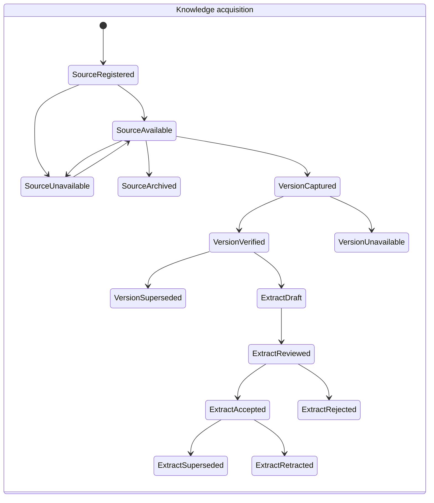
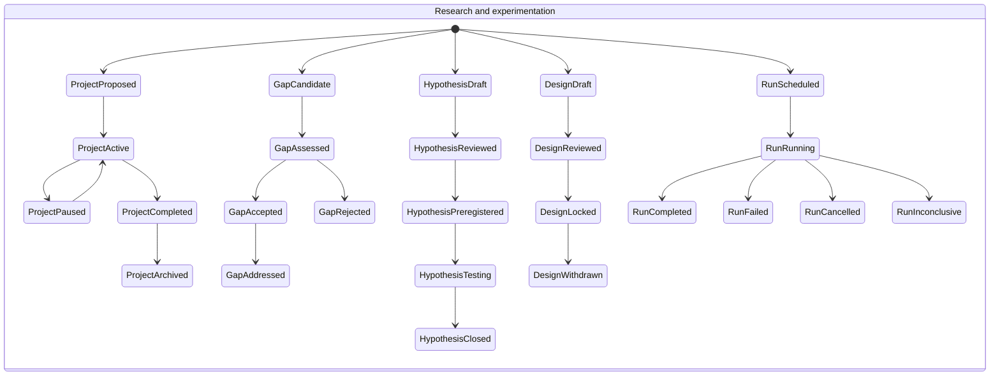
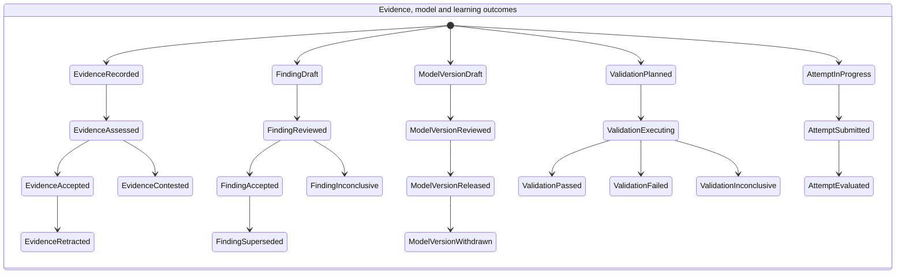

# Phase 0 — Scientific Relationships and Lifecycles

**Status:** Logical contract baseline; implementation and stakeholder ratification remain gates.  
**Entity/ownership rules:** [Domain contracts](./09-phase-0-domain-contracts.md).  
**ERD:** [Entity relationship diagram](./10-phase-0-entity-relationship-diagram.md).

## 1. Relationship record and validation contract

A scientific relation is an asserted, directed semantic fact—not a visual edge or an arbitrary target string. Its minimum record contains:

- Stable `relation_id`; controlled `predicate`; subject and object stable entity IDs and registry types.
- Optional exact subject/object version IDs; mandatory when the predicate rule says interpretation depends on version.
- Optional owning/context project for project-scoped interpretation.
- A non-empty scope key (for example `primary`, a named outcome, or a criterion scope) and a unique assertion key.
- Created-by actor, UTC creation time, rationale/locator as required by predicate, and linked provenance/evidence records.
- Append-only relation lifecycle events. Retraction or reinstatement changes the derived current projection, not the original assertion row.

`SourceVersion`, `FrameworkVersion`, `ModelVersion`, and other `*Version` records have their own version IDs under stable entity IDs; they are not separate polymorphic registry targets. A versioned endpoint is represented as `(entity_id, entity_type, version_id)`. The registry FK proves the identity exists; the composite version FK proves that the pinned version belongs to that identity.

Rust validates all inputs and emits a typed error. SQLite FKs, a versioned `(predicate, subject_type, object_type)` allowlist, required-pin triggers, and structural junction constraints provide a second integrity boundary. A predicate/type pair not present in the allowlist is invalid. No relation is accepted only because its UI label or JSON string looks valid.

### 1.1 Predicate catalog

Stored direction is **subject → object**. `X@v` means an exact version of stable entity `X` is required. “N:M” means each side may participate in many relation rows. Any stronger cardinality is stated explicitly. This is the initial vocabulary; adding or changing a pair requires an ADR, endpoint validation tests, and a migration/versioned rule-catalog update.

| Predicate | Allowed subject → object | Cardinality / required semantics |
|---|---|---|
| `cites` | `SourceClaim`, `ResearchGap`, `ResearchFinding`, `Framework@v`, `ExperimentDesign@v`, `AnalysisDefinition@v` → `Source@v` or `Segment` pinned to `Source@v` | N:M. Exact source version required; citation locator/quotation/attribution retained when available. |
| `derived_from` | `Extract` → `Segment`/`Source@v`/prior `Extract`; `Concept@v`/`Principle@v`/`SourceClaim` → source claim/extract/evidence; `Observation`/`Pattern`/`Idea`/`Hypothesis@v`/`ResearchFinding`/`Model@v`/`Framework@v` → declared exact inputs | N:M. Transformation and all exact input versions required; strict ancestry pairs are acyclic. |
| `defines` | `SourceClaim` or `Concept@v`/`Principle@v` → `Concept@v`, `Principle@v`, or `MeasureDefinition@v` | N:M. Definition meaning, source/context and exact versions retained; multiple sourced definitions may coexist. |
| `contains` | `Framework@v` → `Concept@v`, `Principle@v`, `SourceClaim`, `ResearchFinding`, or `LearningObjective@v` | N:M, ordered typed membership; membership uniqueness is `(framework_version, member, member_version, role)`. |
| `in_domain` | `ResearchProject`, `ResearchGap`, `ResearchQuestion`, `Phenomenon` → `ResearchDomain` | N:M. Project/domain pair unique; exact domain version only if its classification semantics are versioned. |
| `addresses` | `ResearchQuestion` → `ResearchGap` | N:M; relation records which gap motivated/was addressed by the question. |
| `investigates` | `ResearchProject` → `ResearchGap`, `ResearchQuestion`, or `Phenomenon` | N:M; project ownership is a separate required ownership FK, not this relation. |
| `measures` | `ObservationPlan@v` or `ExperimentDesign@v` → `Phenomenon` or `MeasureDefinition@v` | N:M. Operational measure, units, scale, instrument/procedure and role are recorded. |
| `observed_in` | `Observation` → `Phenomenon`, `ExperimentRun`, or `Dataset@v` | Each observation has exactly one primary context; additional contexts are explicit. Capture time/precision, sample, unit, instrument and provenance required as applicable. |
| `tests` | `ExperimentDesign@v` or `ExperimentRun` → `Hypothesis@v` or `Model@v` | N:M. Run's exact design version is a structural FK; observed target cannot silently differ from the preregistered target. |
| `analyzed_by` | `Dataset@v`, `Observation`, or an explicit observation-set identity → `AnalysisRun` | N:M. Exact input version, split/role, selection and method are in the immutable input manifest. |
| `produces` | `ExperimentRun`, `AnalysisRun`, or `AssessmentAttempt` → `Observation`, `Dataset@v`, `Evidence`, `ResearchFinding`, `ModelEvaluation`, or `CompetencyRecord` | 0..N outputs per producer. Output points back to its producer; output checksum/version and time captured. |
| `supports` | `Evidence`, `ResearchFinding`, `HypothesisAssessment`, `Validation`, `Replication` → `SourceClaim`, `Hypothesis@v`, `ResearchFinding`, `Model@v`, or `Framework@v` | N:M. Scoped support is not truth; polarity, rationale, evidence origin and exact target version are required. |
| `contradicts` | Same evidence/assessment subjects as `supports` → same target families | N:M. Conflict scope and rationale required; never deletes or negates the original supporting evidence. |
| `validates` | `Validation` → `Model@v`, `Framework@v`, `ResearchFinding`, or `SourceClaim` | One or more explicit versioned targets; criteria, population, method, evaluator independence/conflict and outcome required. |
| `refines` | New `Hypothesis@v`, `Model@v`, `Framework@v`, `Concept@v`, or `Principle@v` → prior compatible version/identity | Directed newer→prior; lineage may branch. Rationale and preserved scope stated; does not assert validation. |
| `extends` | New `Model@v`, `Framework@v`, `Concept@v`, or `Principle@v` → prior compatible version/identity | Directed newer→prior; scope delta and compatibility stated. |
| `revises` | New `SourceClaim`, `ResearchFinding`, or version of `Hypothesis`, `Model`, `Framework`, `Concept`, or `Principle` → prior compatible record/version | Directed newer→prior; changed assumption/conclusion, reason and evidence recorded. |
| `supersedes` | New compatible record/version → prior record/version | Directed newer→prior; old remains queryable. Branches are allowed; a unique current recommendation is a separate projection, not a uniqueness assumption on history. |
| `replicated_by` | Original `ExperimentRun` or `ResearchFinding` → `Replication` | One primary original per replication; an explicit replication record may name additional related originals. Replication kind, independence, protocol, data context, deviations and result are required. |
| `based_on` | `Hypothesis@v`, `ExperimentDesign@v`, `AnalysisDefinition@v`, `ResearchFinding`, `Model@v`, `Framework@v`, `LearningObjective@v` → exact source/claim/concept/principle/finding/model/framework/dataset versions | N:M. Pins exact version wherever endpoint is versioned and records use context. |
| `originated_from` | New research/knowledge/model record → source, project, question, phenomenon, observation, prior typed record/version | N:M. Provenance, not necessarily causal derivation; origin is never inferred from title/path. |
| `adopts` | Receiving `ResearchProject` or `LearningObjective` → exact `Framework@v`, `Model@v`, `ResearchFinding`, `Concept@v`, or `Principle@v` | N:M. A `KnowledgeTransfer` is mandatory and records attribution, eligibility, review, license, acceptance and context. |
| `implements` | `Model@v` → `ModelSpecification@v` | Exact implementation/specification pair; the model version carries artifact/checksum/environment references. |
| `assesses` | `AssessmentAttempt` → `LearningObjective@v` or `Competency`; `HypothesisAssessment` → `Hypothesis@v`; `ModelEvaluation` → `Model@v`; `Validation` → its predeclared target | Criteria/rubric/metric version, evaluator, evidence, scope and outcome required. This relation does not collapse Learning, HypothesisAssessment and ModelEvaluation semantics. |
| `retracts` | `ProvenanceEvent` with event kind `retract` → a scientific entity or relation | Event carries actor/time/reason and preserved prior state/hash; this is a lifecycle event, not physical deletion. |

Relation endpoint pairs not listed above—including future Theory, generic object, or raw canvas endpoints—are rejected until explicitly specified. Project ownership itself is stored in the ownership columns, not modeled as an `owns` edge that could disagree with them.

### 1.2 Uniqueness, cardinality, and version pinning

- `relation_id` and the canonical `assertion_key` are unique. The assertion key is computed from predicate, typed endpoint IDs, exact version IDs or an explicit no-pin marker, context project, and scope key. A repeat command with the same key is idempotent; attaching additional provenance augments that assertion rather than creating duplicate meaning.
- Separate scopes, endpoint versions, or target criteria are separate assertions. A retracted assertion can be reinstated by a new append-only event; it is not deleted/reinserted.
- Predicate rules define `requires_subject_version`, `requires_object_version`, maximum/exact cardinalities where needed, and cycle policy. DB triggers verify pin presence and entity/version match. Rust returns the precise validation error.
- Version pins are required for citations, adoption, framework membership, experiment/analysis inputs and any relation whose interpretation changes when its endpoint version changes. Identity-only links are allowed only for explicitly version-independent predicates.
- A visual canvas edge stores a relation ID and presentation data. Removing an edge deletes only the visual projection; retracting a scientific relation is a separate confirmed domain operation.

## 2. Lifecycle contract

Lifecycle is not epistemic outcome. In particular, `supported`, `validated`, `replicated`, `mastered`, and `established` are different records/predicates and are never collapsed into one status.

| Entity | Lifecycle and immutability rule |
|---|---|
| `Source` | Registered → available/unavailable → archived. Identity metadata corrections are events; source availability is not content. |
| `SourceVersion` | Captured → verified/unavailable/superseded. Captured bytes and metadata immutable; no inferred edition. |
| `Segment` | Active → archived/replaced; locator changes preserve old Extract pins and record correction. |
| `Extract` | Draft → reviewed → accepted/rejected → superseded/retracted; each transform/correction is a new record. |
| `SourceClaim` | Attributed → challenged/retracted; source assertion remains distinct from app assessment or research finding. |
| `Concept` | Proposed → reviewed → accepted/deprecated. Meaning change creates a new version; scientific support is not a Concept lifecycle state. |
| `Principle` | Proposed → reviewed → active/contested/deprecated. Meaning change creates a new version; supporting/contradicting evidence remains separately assessable. |
| `Framework` / `FrameworkVersion` | Framework draft → reviewed → published → retired; version draft → reviewed → published/withdrawn. Published composition immutable. |
| `LearnerProfile` | Active → archived; archival does not erase attempts/competency history. |
| `LearningObjective` / version | Draft → active → retired; version is immutable; criteria change creates a new version. |
| `Assessment` / `AssessmentVersion` | Draft → reviewed → locked/published → retired/withdrawn; versions are immutable once locked/published. |
| `AssessmentAttempt` | In progress → submitted → evaluated; submitted response/artifact is immutable; corrections append evaluator events. |
| `Competency` / `CompetencyRecord` | Competency proposed → active → retired; records are append-only outcomes with rubric/evidence, not a mutable mastery flag. |
| `ReproductionRecord` | Planned → attempted → evaluated; each attempt is a distinct immutable record. |
| `ResearchProject` | Proposed → active ↔ paused → completed → archived; archival requires no destructive cascade. |
| `ResearchDomain` | Proposed → active → deprecated; cycles in parent hierarchy rejected. |
| `ResearchGap` | Candidate → assessed → accepted/rejected → addressed/superseded; acceptance requires cited literature/prior-knowledge basis or reasoned exception. |
| `ResearchQuestion` | Parked → triaged → active → answered/closed/archived; downstream use prevents delete; promotion preserves identity. |
| `Phenomenon` | Identified → characterized → retired; changed scope is revisioned. |
| `MeasureDefinition` / version | Draft → reviewed → active → retired; changed units/operational semantics create a new version. |
| `ObservationPlan` / version | Draft → reviewed → preregistered/locked → executed/withdrawn; locked plan immutable. |
| `Observation` | Captured → quality-reviewed → accepted/excluded/retracted; captured value/context immutable; correction supersedes. |
| `Pattern` | Candidate → examined → supported/unsupported/retired; remains exploratory and is not promoted in-place to finding. |
| `Idea` | Captured → explored → linked to a new typed output / abandoned; idea remains an idea. |
| `Hypothesis` / version | Draft → reviewed → preregistered → testing → closed; locked text/operational definitions immutable. Outcome is separately assessed. |
| `HypothesisAssessment` | Recorded → superseded/retracted by event; outcome supported/partial/rejected/inconclusive/unresolved is scoped and immutable. |
| `ExperimentDesign` / version | Draft → reviewed → preregistered/locked → retired/withdrawn; changes after lock create a new version. |
| `ExperimentRun` | Scheduled → running → completed/failed/cancelled/inconclusive; terminal inputs, deviations and outcome retained; retry is new run. |
| `Dataset` / `DatasetVersion` | Dataset registered → active/restricted/retired; version staged → validated → sealed → superseded/quarantined. Sealed content immutable. |
| `DataSample` / `TradeSample` | Captured → validated/accepted/excluded/retracted; immutable per dataset version; correction is a new sample/version. |
| `AnalysisDefinition` / version | Draft → reviewed → locked/retired; a run pins a specific immutable version. |
| `AnalysisRun` | Queued → running → completed/failed/cancelled; immutable inputs; every retry is new. |
| `Evidence` | Recorded → assessed/accepted/contested/rejected → superseded/retracted; artifact/provenance retained. |
| `ResearchFinding` | Draft → reviewed → accepted/contested/unsupported/inconclusive → superseded/retracted; correction creates new finding/version. |
| `Model` / `ModelVersion` | Model proposed → active → deprecated/replaced/retired; version draft → reviewed → released → superseded/withdrawn; released version immutable. |
| `ModelEvaluation` | Queued → running → completed/failed/inconclusive; result pins model/data/method versions and is append-only. |
| `Validation` | Planned → executing → passed/failed/inconclusive → superseded; criteria and population locked before evaluation. |
| `Replication` | Planned → executing → completed/failed/inconclusive → assessed; independent record never overwrites original. |
| `ResearchLineage` | Append-only origin/adaptation assertions; correction is an event. |
| `KnowledgeTransfer` | Proposed → under review → accepted/rejected → adapted/withdrawn; historical adoption remains queryable. |
| `ScientificRelation` | Asserted → retracted/superseded/reinstated through append-only events; assertion payload is immutable. |
| `ProvenanceEvent` | Append-only; UPDATE/DELETE prohibited by service and database trigger. |

### 2.1 Lifecycle diagrams

These are representative state diagrams; the lifecycle table is normative for the full entity set. Terminal outcomes remain distinct; transitions are backend operations with actor/time/reason and optimistic concurrency.

## 3. Deletion, correction, and append-only history

- Scientific tables use explicit restrictive FK behavior. No project, source, model, dataset, framework, or other scientific parent deletion may cascade to scientific children, runs, observations, evidence, findings, relations, versions, or transfer history.
- User-facing removal means archive/restrict/withdraw/retract. Physical purge is not part of this phase and requires a separately approved privacy/retention policy and a proven impact report.
- Scientific assertions, observations, submitted attempts, sealed data, runs, evaluations, findings, versions, relation assertions and provenance events are append-only in meaning.
- Mutable drafts may use optimistic revision numbers. Once pinned by a run, publication, assessment, or transfer, edits create new immutable versions/records.
- Corrected measurements, claims and findings retain the old record and point to it via `supersedes`/`revises`; old citations and run inputs remain resolvable.
- Database triggers prevent UPDATE/DELETE for append-only records. Rust transactions ensure the original plus correction/event commit atomically.
- `RESTRICT` on a referenced asset/entity blocks physical deletion. Asset garbage collection and cryptographic erasure remain unresolved.

## 4. Transaction boundaries

Persisted user operations follow `UI → hook/store → typed service → Tauri command → owning domain service → repository transaction → SQLite`. Rust domain service owns invariants; UI validation is advisory; Tauri command parsing is not business logic.

| Operation | Atomic unit |
|---|---|
| Create entity | Registry identity + exactly one typed subtype + initial provenance event + required owner/version references. All succeed or none. |
| Edit mutable draft | Validate expected revision, write new content/revision and provenance event atomically; stale revision returns conflict. |
| Create immutable version | Stable identity check + version identity/subtype + parent links + content checksum + provenance event + active pointer/event update atomically. |
| Lock/preregister/publish | Validate required fields, predicate pairs, FKs, pinned versions and integrity declarations; append transition/version event and seal exact version in one `BEGIN IMMEDIATE` transaction. |
| Create relation | Validate allowlist, endpoints, version pins, ownership context, cardinality/cycle rules, and idempotency key; insert relation plus provenance atomically. |
| Retract/correct/reinstate | Append immutable event/replacement record and update only a derived/current projection in the same transaction. Original payload stays unchanged. |
| Record observation/attempt/evidence | Insert immutable record, exact source/run/version refs, asset manifest refs and provenance event atomically. External payload must be staged and hash-verified first. |
| Queue or start long analysis | Commit queued/running run identity, immutable input manifest and run event; release DB transaction before computation. Never hold SQLite writer locks during analysis. |
| Finalize run/analysis | Validate outputs and hashes; insert output manifests/results/deviations and terminal status/event atomically. Failure records a failed state/event; it does not erase the run. |
| Adopt/transfer | Validate source/recipient, exact version, policy/license/review and lineage; insert transfer/adoption relation and provenance in one transaction. |
| Migration | One numbered migration, DDL/DML, `schema_migrations` checksum row and `PRAGMA user_version` update commit atomically. Complex rebuilds run against a staged DB; see migration contract. |

SQLite transactions do not cover filesystem and DB atomically. Immutable external assets therefore use a staged-write protocol: write/hash/fsync asset first, commit DB reference second, and leave an unreferenced staged/orphan asset for safe later reconciliation on failure. Never commit a DB reference before the asset is durable. Run computation and network access occur outside write transactions.

## 5. Error and concurrency contract

- Every operation either returns its committed typed result or an actionable error; no silent FK disable, empty-object fallback, swallowed migration error, or optimistic success on failed persistence.
- State transitions and relation uniqueness are validated in the same transaction as writes. Duplicate requests use stable idempotency keys; concurrent conflicting updates use expected revision/version and return conflict.
- Every opened SQLite connection must enable and verify `PRAGMA foreign_keys=ON` before transactions. A connection failing the verification is not admitted for scientific writes.
- Writer transactions use a bounded busy timeout and explicit error mapping. Long-running work uses run records and immutable inputs, not an open transaction.
